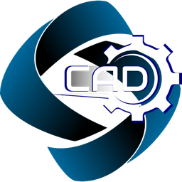
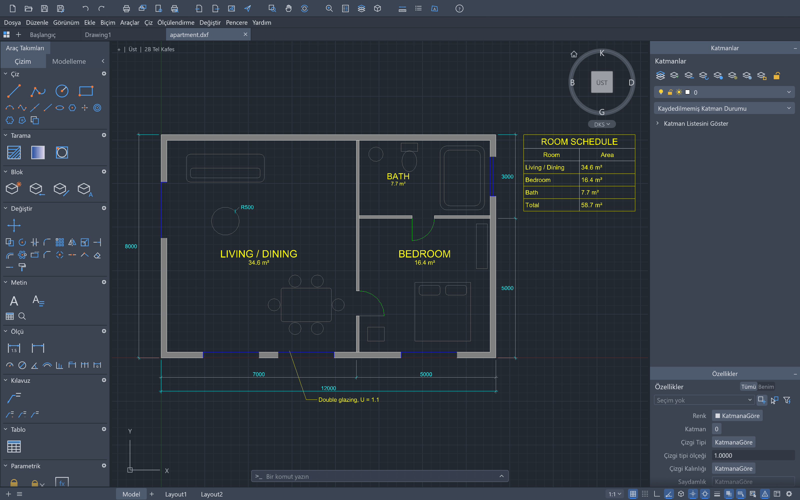

<p align="center">
  
</p>

<h1 align="center">SP-GROUP CAD</h1>

<p align="center">
  <b>egui arayüz çerçevesi ve wgpu grafik altyapısıyla geliştirilen, saf Rust tabanlı bilgisayar destekli tasarım ve teknik çizim uygulaması.</b>
</p>

<p align="center">
  Komut satırı, nesne yakalama, katmanlar, ölçülendirme, tarama, bloklar ve DXF/DWG dosyalarıyla tanıdık bir CAD akışı.
  macOS, Windows, Linux ve FreeBSD üzerinde yerel; WebAssembly ile tarayıcıda çalışır.<br>
  <i>Kısa ad: SPCAD. SP-GROUP tarafından sürdürülen bu dağıtım, açık kaynaklı CADCraft projesi üzerine inşa edilmiştir.</i>
</p>

<p align="center">
  
  
  
  
  
</p>

<p align="center">
  
  <br><sub><b>Kat planı</b> (<a href="ornekler/apartment.dxf">ornekler/apartment.dxf</a>): duvarlar, TrueType MTEXT oda etiketleri, TABLE, MLEADER ve mimari ölçüler — tamamı SP-GROUP CAD komutlarıyla üretildi.</sub>
</p>

## Özellikler

- **Dosya biçimleri:** DXF okuma (R12–2018, ASCII ve binary) ve yazma (R2000); DWG okuma/yazma (R2000, `acadrust` köprüsü); PDF çizimi, SVG ve PNG dışa aktarma.
- **Komut satırı:** İstemler ve anahtar sözcükler, geçmiş, otomatik tamamlama, takma adlar, `@dx,dy`, `@d<a`, `#x,y`, doğrudan mesafe girişi, Enter/boşluk/sağ tık ile yineleme, saydam komutlar ve `.scr` betikleri.
- **Çizim:** LINE, PLINE (yay ve genişlik), CIRCLE, ARC, RECTANG, POLYGON, ELLIPSE, SPLINE, POINT, XLINE, RAY, DONUT, TEXT ve MTEXT.
- **Düzenleme:** ERASE, MOVE, COPY, ROTATE, SCALE, MIRROR, STRETCH, OFFSET, TRIM, EXTEND, FILLET, CHAMFER, BREAK, JOIN, EXPLODE, dikdörtgen ve kutupsal ARRAY, çizim sırası ve OVERKILL.
- **Hassasiyet:** Uç, orta, merkez, geometrik merkez, düğüm, çeyrek, kesişim, ekleme, dik ve teğet nesne yakalama; kutupsal izleme, ortho ve ızgara yakalama.
- **Katmanlar ve özellikler:** Katman paleti ve Katman Özellikleri Yöneticisi (açma/kapama, dondurma, kilitleme, çizim, renk, çizgi tipi), katman araçları, Özellikler paleti, çizgi tipleri, çizgi kalınlıkları, renk indeksi ve gerçek renk.
- **Ölçülendirme:** Tüm DIM* komutları, DIMSTYLE değişkenleri ve geçersiz kılmalar, tüm ok uçları, geometriyi izleyen ilişkisel ölçüler, MLEADER, TABLE, TrueType yazı tipleri, MTEXT biçim kodları ve kendi tek çizgili teknik yazı tipimiz.
- **Tarama ve bloklar:** Ada destekli nokta seçimli tarama sınırları, desenli/dolu/geçişli dolgular, kendi desen kitaplığımız, BLOCK/INSERT, nitelikler ve iç içe bloklar.
- **Yerleşimler ve çıktı:** Kâğıt alanı yerleşimleri, görünüm pencereleri (ölçek, kilit, pencere başına katman dondurma), MSPACE/PSPACE, sayfa kurulumları, PLOT ve EXPORTPDF.
- **Parametrik:** Geometrik ve boyutsal kısıtlar, AUTOCONSTRAIN, ifadeli PARAMETERS ve çakışma denetimi; her düzenlemeden sonra kısıtlar yeniden çözülür.
- **Tutma noktaları:** Sıcak tutma noktaları; Space ile Stretch, Move, Rotate, Scale ve Mirror arasında geçiş.
- **Arayüz:** 16 arayüz dili (Türkçe dâhil), canlı dil değiştirme; koyu/açık/sistem tema seçimi; klavye odağı ve erişilebilir etiketler; 44 px hedefli dokunma alanları.
- **Ajan erişimi:** MCP sunucusu, JSON denetim kanalı ve `spcad-cli` (info, convert, run, commands, sample, mcp).
- **Platformlar:** macOS, Windows, Linux, FreeBSD ve WebAssembly; aynı komut kaydı masaüstü, CLI, denetim kanalı ve MCP tarafından paylaşılır.

> [!NOTE]
> Bu dağıtımda ArtCraft adı, kelime işareti ve logoları kaldırılmıştır. Uygulama ikonu ve görünen ad SP-GROUP'a aittir. Özgün açık kaynak projenin MIT/Apache-2.0 telif bildirimleri korunur; ayrıntılar [Lisans](#lisans) bölümündedir.

## Hazır Uygulama

Paketleme betikleri `dist/release/` altında platforma özgü çıktılar üretir; depoda derlenmiş ikili tutulmaz.

| Platform | Çıktı | Not |
|---|---|---|
| Windows | `spcad-<sürüm>-windows-<mimari>.msi`, `...-portable.zip` | MSI makine genelinde kurulur; taşınabilir ZIP kurulum gerektirmez |
| macOS | `spcad-<sürüm>-macos-universal.dmg`, `spcad-cli-...zip` | İmzalı ve noter onaylı üretim için `paketleme/macos/package.sh` |
| Linux | AppImage, `.deb`, `.rpm`, `.tar.gz`, Flatpak | `paketleme/linux/package.sh` |
| FreeBSD | `spcad-<sürüm>-freebsd-x86_64.tar.gz` | FreeBSD VM'de release iş akışıyla üretilir |
| Web | Statik site ZIP'i | `paketleme/web/package.sh`; WebAssembly derlemesi |

Sürüm numarası paket dosya adlarına girer. Windows MSI ve taşınabilir ZIP, C çalışma zamanını statik bağladığı için Visual C++ yeniden dağıtım paketi gerektirmez.

## Kaynaktan Derleme

Gereksinimler:

- Rust 1.90 veya üzeri.
- Windows'ta MSVC hedefi ve Visual Studio 2022 C++ Build Tools (Windows SDK ile birlikte).
- Linux/macOS/FreeBSD'de sistem derleyicisi ve platformun pencere/GPU kitaplıkları.
- Web derlemesi ve `cargo xtask ci` için `rustup target add wasm32-unknown-unknown`.

```sh
cargo build --release -p spcad
cargo run --release -p spcad -- --sample
```

Derleme çıktısı `target/release/` altında oluşur (Windows'ta `spcad.exe`) ve depoya girmez. Web derlemesi için `cargo xtask wasm`, ardından `paketleme/web/package.sh` çalıştırılır.

Her commit öncesi kalite kapısı:

```sh
cargo xtask ci
```

Bu komut sırasıyla biçim denetimi, `clippy -D warnings`, testler, varlık telifi (`assets`), katman denetimi (`layers`) ve WASM denetimini çalıştırır. Tekil denetimler:

```sh
cargo xtask assets     # ATTRIBUTION.md eksiklerini gösterir
cargo xtask layers     # katman ihlallerini gösterir
cargo xtask wasm       # wasm32 hedefi için kontrol
cargo xtask parity     # menü genişliği kontrol listesini yeniler
```

## Geliştirici Kurulumu

```sh
git clone https://github.com/spgroupenerji/app-CAD.git
cd app-CAD
cargo xtask ci
```

> Bu dağıtımın kaynağı: `https://github.com/spgroupenerji/app-CAD`. Özgün proje:
> `https://github.com/storytold/cadcraft` (MIT OR Apache-2.0).

Bağımlılıklar ilk derlemede `Cargo.lock` sürümleriyle iner; sonraki derlemeler artımlıdır. `target/` makineye ve yola özgüdür, depoya eklenmez ve kopyalanamaz.

Depo yapısının ve katmanların yaşayan otoritesi [belgeler/YAPI.md](belgeler/YAPI.md) dosyasıdır. Ayrıntılı teknik anlatım [belgeler/mimari.md](belgeler/mimari.md), iş listesi [belgeler/eksikler.md](belgeler/eksikler.md), yol haritası [belgeler/yol-haritasi.md](belgeler/yol-haritasi.md) içindedir.

## Komut Satırı, MCP ve Ajan Erişimi

Masaüstü uygulamasını örnek çizim ve denetim kanalıyla başlatın:

```sh
cargo run --release -p spcad -- --sample --control 7981
```

Denetim kanalı yalnızca `127.0.0.1` üzerinde dinler. JSON satırlarıyla sürücü:

```sh
{"id":1,"method":"cmdline.input","params":{"text":"circle 0,0 5"}}
{"id":2,"method":"engine.execute","params":{"command":"line","params":{"points":[[0,0],[10,0]]}}}
{"id":3,"method":"ui.screenshot","params":{"path":"/tmp/shot.png"}}
```

Yöntemler [kitapliklar/arayuz-egui/src/denetim.rs](kitapliklar/arayuz-egui/src/denetim.rs), sözleşme [belgeler/denetim-protokolu.md](belgeler/denetim-protokolu.md) içindedir. Başsız kullanım:

```sh
spcad-cli run --sample --script 'LINE 0,0 10,10\n' --export out.png
spcad-cli info file.dxf
spcad-cli mcp
```

Programatik çağrılar iletişim kutusu açmaz; yalnızca menü/toolbar etkileşimli istem dizisini başlatır. Komut satırı, menüler, araç takımları, betikler, CLI, denetim kanalı ve MCP aynı `CommandSpec` kaydına gider.

## Güvenlik

- Uygulama yalnızca kullanıcı tarafından açılan yerel dosyaları işler; arka planda ağ isteği yapmaz, telemetri toplamaz ve kullanıcı verisi iletmez. Kod tabanında HTTP istemcisi bağımlılığı yoktur; yalnızca kullanıcı bir bağlantıya tıkladığında varsayılan tarayıcı açılır.
- Denetim kanalı yalnızca açıkça `--control` veya `SPCAD_CONTROL_PORT` verildiğinde ve yalnızca `127.0.0.1` üzerinde çalışır. MCP stdio üzerinden veya yerel köprüyle kullanılır.
- Dosya biçimi okuyucuları düşman girdiye karşı sınırlıdır: sınır denetimli okuma, sınırlı bellek ayırma, özyineleme sınırı ve `catch_unwind` koruması. Bozuk veya eksik dosyalar kullanıcıya anlaşılır hata döndürür; uygulama çalışmaya devam eder.
- Üretim kodunda `unsafe` yasaktır; `unwrap`, `expect`, `panic!`, `todo!`, `unimplemented!` ve `unreachable!` clippy tarafından derleme hatasına dönüştürülür.
- Ayarlar ve pencere yerleşimi kullanıcı profilinde (`%APPDATA%\SPCAD`, macOS `~/Library/Application Support/SPCAD`, Linux/BSD `~/.config/spcad`) tutulur. `SPCAD_CONFIG_DIR` ile taşınabilir bir profil seçilebilir. Günlükler teknik tanılama içindir; kimlik bilgisi, parola veya oturum jetonu yazılmaz.
- Windows MSI makine genelinde kurulur ve yönetici hakları ister; taşınabilir ZIP yönetici hakları gerektirmez. MSI, `.dxf`/`.dwg` için yalnızca "Birlikte Aç" kayıtları yazar; varsayılan uygulamayı değiştirmez.
- Çizim dosyaları ve varlıklar temiz oda ilkesiyle ele alınır: Autodesk, Adobe veya Avid ikonografisi, yazı tipi, desen veya şablonu kopyalanmaz. Dosya biçimleri kamuya açık şartnamelerden ve kendi sentetik testlerimizden gelir.

## Sorun Giderme

- **Windows'ta uygulama açılmıyor:** Varsayılan olarak yalnızca DirectX 12 başlatılır. Sürücü kaynaklı sessiz çıkışta `WGPU_BACKEND=vulkan` veya `WGPU_BACKEND=dx12` ile deneyin.
- **Günlükler:** Ayar dizinindeki `logs/spcad.log` dosyasına yazılır (Windows `%APPDATA%\SPCAD\logs\`, macOS `~/Library/Application Support/SPCAD/logs/`, Linux/BSD `~/.config/spcad/logs/`). `RUST_LOG=debug` ayrıntıyı artırır; `--version` günlük dosyası oluşturmaz.
- **Yazı tipleri:** Sistemdeki TTF/OTF/TTC yazı tipleri kullanılır. SHX dosyaları henüz okunmaz; bu stillerde kendi tek çizgili yazı tipimiz devreye girer. `FONTALT` ve `FONTFALLBACK` ile yedek yazı tipi seçilebilir. `CRAFT_FONTS_DIR` isteğe bağlı bir derleme girdisidir; varsayılan derleme onsuz da çalışır.

## Sürümlandırma

Sürüm iki parçadan oluşur: kök `Cargo.toml` içindeki `[workspace.package] version` semver çekirdeği (`MAJOR.MINOR.PATCH`) ve derleme anındaki UTC zaman damgası. Kullanıcıya gösterilen sürüm:

```text
MAJOR.MINOR.PATCH_vYYYYMMDDHHMM
```

Çekirdek tek kaynaktır; tüm kitaplıklar bu değeri devralır. Cargo sürüm alanında alt çizgi kabul etmediği için `_v<YYYYMMDDHHMM>` eki yalnızca gösterim sürümüne eklenir ve `kitapliklar/motor/build.rs` tarafından derlemeye gömülür.

```sh
cargo xtask version              # semver çekirdeğini yazdırır
cargo xtask version set 0.11.0   # çalışma alanı sürümünü günceller
```

Damga derleme anında UTC olarak üretilir; `SPCAD_BUILD_STAMP=YYYYMMDDHHMM` ile sabitlenebilir. Derleme kimliği `SPCAD_BUILD_SHA` ortam değişkeninden gelir; paketleme betikleri bunu git başlığından üretir. `spcad --version` çıktısı sürüm ve derleme kimliğini birlikte gösterir:

```text
spcad 0.10.0_v202610220830 (<git-sha>)
```

Paket dosya adları `spcad-<sürüm>-<platform>-<mimari>` biçimindedir; buradaki `<sürüm>` semver çekirdeğidir. Uygulama içi sürüm aynı çekirdeğe derleme damgasını ekler.

## Depo Yapısı

| Dizin | İçerik |
|---|---|
| `kitapliklar/` | 12 kitaplık: `geom`, `dxf`, `color`, `doc`, `fonts`, `render`, `constraints`, `io`, `dwg`, `engine`, `ui-egui`, `mcp` |
| `uygulamalar/` | `spcad` (masaüstü), `spcad-cli` (başsız), `spcad-web` (WASM) |
| `xtask/` | Çalışma alanı araçları: `ci`, `layers`, `assets`, `wasm`, `parity`, `version`, `stats`, `ico` |
| `varliklar/uygulama-simgesi/` | SP-GROUP marka kaynağı ve üretilmiş uygulama ikonları |
| `paketleme/` | Linux, macOS, Windows ve web paketleme tanımları; `ikonlar.py` ikon üreticisi |
| `belgeler/` | `YAPI.md`, `mimari.md`, parite belgeleri, denetim protokolü ve ekran görüntüleri |
| `katkida-bulananlar/` | Hakkında penceresine derlenen katkıcı verisi |
| `ornekler/` | Kodla üretilmiş örnek çizimler |

`plan/`, `licensing/`, ajan talimatları (`AGENTS.md`, `CLAUDE.md`) ve ajan indeksleri sürüm dışıdır; yerel çalışma dosyalarıdır.

## Lisans

SP-GROUP CAD, MIT veya Apache-2.0 lisanslarından birini seçerek kullanabileceğiniz çift lisanslı bir dağıtımdır. Özgün kod:

> Copyright (c) 2026 ArtCraft Team and the CADCraft contributors.
> Licensed under the MIT License. Required notices are in [NOTICE](NOTICE).

Zorunlu bildirimler [NOTICE](NOTICE), lisans metinleri [LICENSE-MIT](LICENSE-MIT) ve [LICENSE-APACHE](LICENSE-APACHE) dosyalarındadır. Kullanılan tüm varlıkların yazar, kaynak ve lisans bilgileri [ATTRIBUTION.md](ATTRIBUTION.md) içinde listelenir.

Zorunlu kaynak bildirimi:

> Bu çalışmada yer alan temel kod yapıları, MIT Lisansı altında sunulan açık kaynaklı CADCraft
> (github.com/storytold/cadcraft) projesi üzerine inşa edilmiş ve tarafımca yeniden düzenlenmiştir.
> Original Code Copyright (c) 2026 ArtCraft Team and the CADCraft contributors. Licensed under the MIT
> License. (Required notices are in NOTICE.)

> This work builds upon the open-source CADCraft project (github.com/storytold/cadcraft), licensed
> under the MIT License, and has been rewritten by the author.
> Original Code Copyright (c) 2026 ArtCraft Team and the CADCraft contributors. Licensed under the MIT
> License. (Required notices are in NOTICE.)

Bu dağıtımda ArtCraft adı, kelime işareti ve `belgeler/brand/` altındaki logolar kaldırılmıştır. SP-GROUP adı ve [varliklar/uygulama-simgesi/sp-group-cad.png](varliklar/uygulama-simgesi/sp-group-cad.png) logosu SP-GROUP marka varlıklarıdır ve yukarıdaki açık lisans kapsamında değildir. SP-GROUP CAD, Autodesk, Inc. ile bağlantılı değildir; AutoCAD ve DWG Autodesk, Inc.'in tescilli markalarıdır.

DWG okuma/yazma için kullanılan `acadrust` kitaplığı MPL-2.0 altındadır ve değiştirilmeden ayrı bir kitaplık olarak kullanılır; ikili dağıtımda MPL-2.0 dosya düzeyi yükümlülükleri dikkate alınmalıdır. İsteğe bağlı `CRAFT_FONTS_DIR` girdisiyle gömülen yazı tipleri SIL Open Font License 1.1 altındadır.

---

<p align="center">
  <sub>SP-GROUP CAD dağıtımı © 2026 SP GROUP ENERJİ SAN. VE Tİ. LTD. ŞTİ. — info@spgroupenerji.com<br>
  Özgün kod © 2026 ArtCraft Team and the CADCraft contributors; MIT veya Apache-2.0.</sub>
</p>
